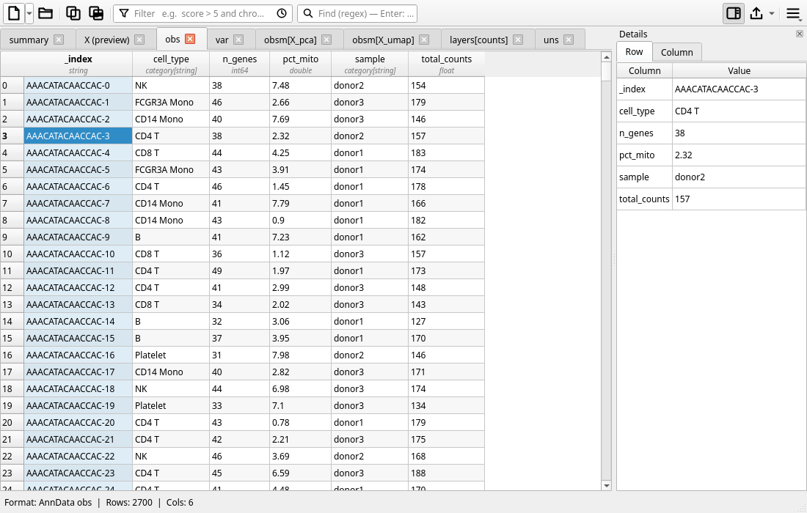
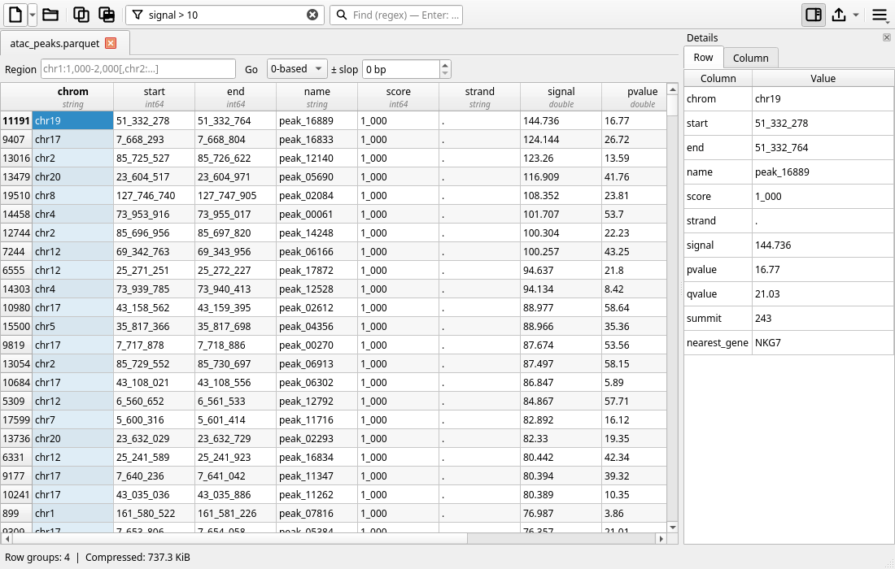
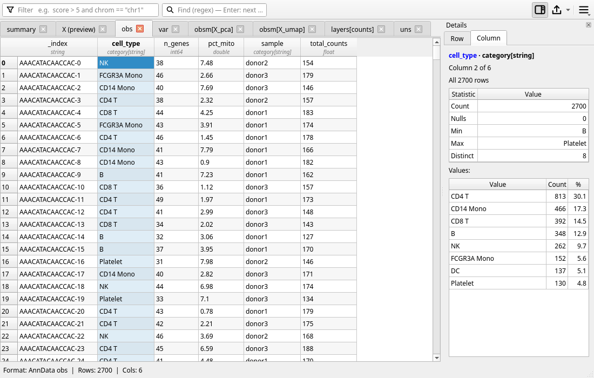
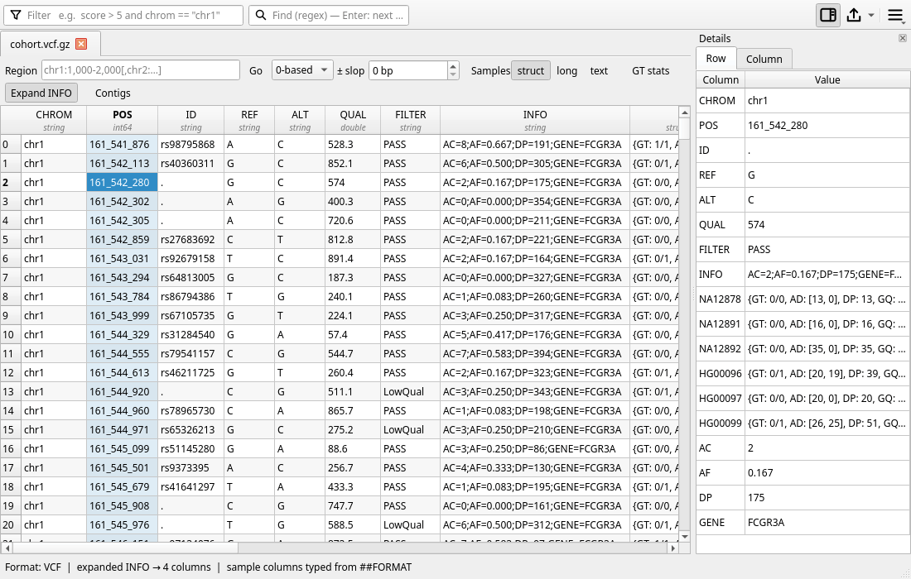
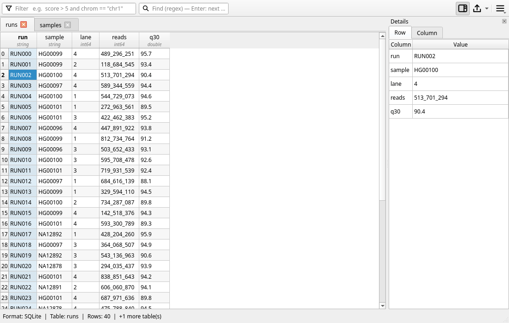
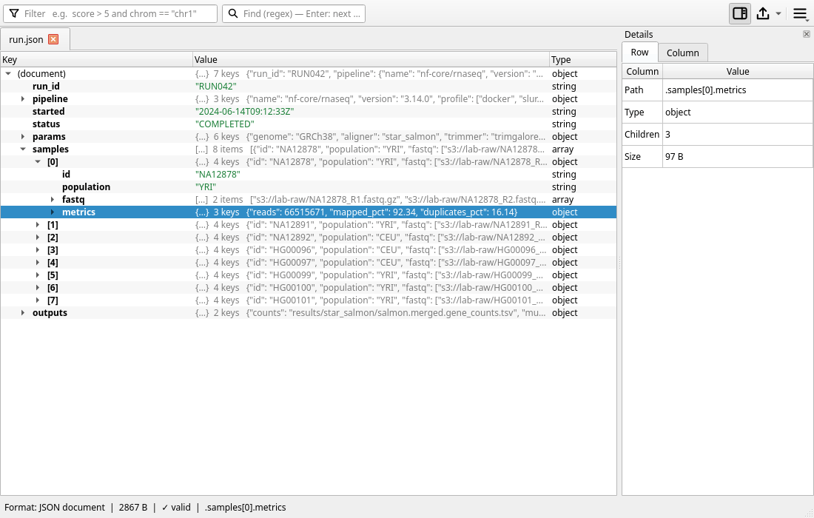
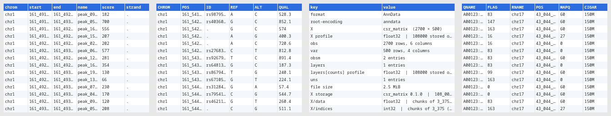

# vvg — the desktop viewer

`vvg` is a Qt6 window over the same reader as `vv`: it opens every format vv
does ([gallery](formats.md)), one tab per file, sheet, table or component.



## Start

```sh
vvg data.parquet                    # or any supported file; several → one tab each
vvg --tab obs cells.h5ad            # vv's view flags open the same view
vvg --filter 'signal > 10' --sort signal:desc peaks.parquet
vvg -r chr17:43044295-43125483 calls.vcf.gz
```

vvg takes vv's view flags — `--filter`, `--select`, `--sort`, `--tab`,
`-r` / `--region` (with `--coords`, `--slop`), `--tags`, `--pileup`,
`--gt-stats`, `--contigs`, `--samples`, `--matrix` — and *Edit ▸ Copy as vv
Command* goes the other way.



## The window

- **Toolbar** — one row: the *Filter* and *Find* boxes, then on the right
  *Details* (*Ctrl+B*, the Row / Column panel), *Export…* (*Ctrl+E*; its ▾ has
  *Copy as vv Command* and *Open Export Directory*) and **≡**, the menu (*F10*, or
  right-click the toolbar): open, recent files, close, *Edit ▸*, *View ▸*,
  *Help ▸*, quit. The classic File / Edit / View / Help menu bar holds the
  same and is off unless *View ▸ Menu Bar* is checked (always on with a
  native macOS menu bar). Below 1150 px the buttons drop their labels.
- **Format options** — under the tab bar, a strip with the options the
  current tab's file offers, and nothing else; a tab with none (a CSV, an
  AnnData `obs`) has no strip. Each file keeps its own options: a change
  re-opens that file's tabs only, in place, and the other files keep their
  filters, sorts and columns.

  | File / tab | Options |
  |---|---|
  | BAM / CRAM | Region, *Pileup* (mpileup rows), *Tags* (`NM,AS,RG` → typed columns), *Contigs* |
  | SAM / PAF | Region, *Tags* (SAM also *Contigs*) |
  | VCF / BCF | Region, *Samples* struct / long / text and *GT stats* (with samples), *Expand INFO*, *Contigs* |
  | GFF / GTF | Region, *Expand attributes* |
  | BED, bedGraph, bigWig / bigBed, 2bit, FASTA, Cooler, GenBank | Region |
  | Parquet with chromosome / start / end columns | Region |
  | HDF5 / AnnData / Loom / 10x / Zarr / R sparse matrix tabs | *Matrix* wide / long |
  | NumPy arrays of 3+ axes | *Slice* ◀ ▶ |

  *Region* takes `chr1:1000-2000` (several, comma-separated; *Enter* or *Go*;
  *Ctrl+L* focuses it), 0- or 1-based coordinates and ± slop. A BAM / CRAM /
  BCF / FASTA without the index a region needs shows the box disabled with the
  command that builds the index; a text file without a tabix index notes that a
  region reads the whole file. Options that do not combine are greyed out
  instead of failing (*Contigs* turns off the record options, *Pileup* turns
  off *Tags*); an option the file cannot take (a malformed region) leaves the
  tabs as they were and says why in the strip. The strip wraps onto more lines
  in a narrow window.
- **Several files** — with two files or more open, each file's tabs are
  underlined in a colour of their own, the first tab of a file of several
  tabs names it (*adata.h5ad ▸ summary*, then *X*, *obs*, …), the strip starts
  with the file's name and colour, and the window title is the current tab's
  file. A tab's tooltip is its file's path. Right-click a tab for *Close File*
  (*Ctrl+Shift+W*), *Close Other Files* and *Copy Path*.
- **Column types** — each header shows the column's type under its name, in
  a smaller, dimmer italic; *View ▸ Column Types* turns the line off.
- The window's size and its docks are restored at the next start.

## What it does

- **Tabs** — files, workbook sheets, SQLite and DuckDB tables, HDF5 / Zarr /
  AnnData components, Cooler resolutions, GenBank sections, POD5 tables, R
  objects and NumPy arrays each get a tab. Open with *File ▸ Open* (its type
  list has every format vv reads, by family: alignments, variants, HDF5, …),
  *Open Directory* (a directory of parts as one dataset), drag-and-drop or the
  recent-files list. A tab reads its file only when first shown, and reads
  in the background: it says *Loading…* until its columns are known, and a
  block of rows not read yet shows `…` until it arrives, so the window stays
  responsive on slow or network storage.
- **Sort, filter, find** — click a header to sort (by type, not text) and
  put the cursor in that column; a second click sorts descending, a third
  restores the file's order (also *Clear Sort* in the header's right-click
  menu and *View ▸*). The Filter box (*Ctrl+Shift+F*) uses vv's `--filter`
  grammar (`score > 5 and chrom == "chr1"`); the Find box (*Ctrl+F*) takes a
  regex. All three run off the UI thread with a progress bar and *Cancel*, so
  multi-GB files stay responsive.
- **JSON tree** — a JSON document (`.json`, `.geojson`, `.ipynb`, `.har`, also
  compressed) opens as a tree: keys, values and types, children loaded as you
  expand, the jq path and validation in the status bar, the value in the detail
  dock. The Find bar searches keys and values (regex or plain text,
  case-insensitive), highlights matching rows and opens the tree to the next
  hit (F3 / Enter again for the next). Right-click → *Open … as Table* shows the array of objects at or above
  the row as a table tab; *Copy Value* / *Copy Path*. JSON Lines, or vv's table
  flags (`--filter`, `--select`, …), open as a table directly.
- **Expand** (on by default) — VCF `INFO` and GFF / GTF `attributes` are split
  into one column per key, sortable and filterable.
- **Samples / Matrix** — the layouts of VCF / BCF sample columns (struct,
  long: one row per record × sample, text) and of HDF5 / AnnData matrix tabs
  (wide, long: one row per stored value, the whole matrix), as vv's
  `--samples` / `--matrix`. A long matrix of more rows than the window can
  scroll (about 70–90 million, by row height) shows the first ones and says
  so; filter and export see them all.
- **Details** (*Ctrl+B*) — the right panel's *Row* tab lists every field of the
  current row; its *Column* tab summarises the cursor's column (below).
  *View ▸ Columns* shows / hides columns; go to row (*Ctrl+G*); *Ctrl+C* copies
  the selection as TSV. *View ▸ Smooth Scrolling* (on by default) scrolls by
  pixels; off, by whole rows and columns.
- **Selection summary** — select two or more cells and the status bar shows
  `Σ 13200.3 · mean 1100.025 · min 0 · max 3200 · 12 numbers` over the
  numeric cells among them (text, dates and hidden columns are skipped; up to
  1,000,000 cells). The numbers are plain, without digit grouping, and the
  text can be selected and copied.
- **Column tab** (*Details ▸ Column*) — the cursor column, tinted in the
  table, by name and position (*Column 7 of 120*); click the name, or
  *→ show in table* when the column is scrolled out of view, to bring it
  back into view. Its count, nulls,
  sum, mean, standard deviation, min, 25% / median / 75%, max and distinct
  count; for a numeric column a histogram of 32 equal-width bins from min
  to max (hover a bar for its interval and count); and its values with
  their counts and shares (the 50 most frequent;
  up to 10,000 distinct values are counted). Over the rows the filter keeps,
  and over the whole tab even where the table shows a preview: an AnnData
  `obs` of 300,000 cells is summarised in full, a matrix tab is labelled as
  the preview it is. It is computed in the background on a second copy of
  the tab, so the table stays usable while a large file is read (*Cancel*
  stops it); one pass covers every column, so moving the cursor afterwards
  is instant. A table of more than 10,000,000 rows (or, while a text
  file's rows are not yet counted, a file over 1 GiB, or a remote file) is
  summarised only on request, one column at a time: the tab shows the row
  count and *Compute Column Statistics*, which reads the cursor column
  alone. A tab read from a pipe is summarised on request (*Compute*).
  The values are plain numbers in ordinary cells: *Ctrl+C* copies the
  selected ones as TSV; right-click for *Copy All as TSV* and *Copy as vv
  Command* (`vv … --describe --select col`). Double-click a value to filter
  the table to it.
- **Copy as vv command** (*Ctrl+Alt+C*, or *Export… ▾*) — the `vv` command
  line that reproduces the tab: file, `--tab`, the file's format options,
  `--filter`, `--sort`, `--select`.
- **Export view** (*Ctrl+E*) — the tab's rows after filter / sort / column
  choice, to Parquet, Arrow, TSV, CSV, JSON or NDJSON, written by vv's own
  writers (every row, not only the visible ones), in the background with
  *Cancel*.

An AnnData / HDF5 / Zarr tab pages through every row of a frame, a 1-D or
2-D array, and a dense or CSR matrix; a matrix tab shows at most 200 data
columns, a CSC matrix at most 1,000 rows, and Loom / Cell Ranger previews
keep their limits.









## KDE Plasma

The `vv-gui` package also integrates with Dolphin:

- double-click / *Open With* opens files in vvg;
- **thumbnails** — a snapshot of the first rows in the icon view;
- **Information Panel** — row and column counts, schema, codec, writer; for
  BAM / SAM / VCF / BCF the reference count, assembly, sort order, read groups
  and samples;
- MIME types for the genomic formats, so `.vcf` is not taken for a vCard,
  `.bam` for an archive nor `.gb` for a Game Boy ROM; also Cooler, Zarr zip,
  wiggle, BLAST tabular, GenBank / EMBL, POD5, DuckDB and R data.



CRAM and FASTA get no thumbnail or panel entry: a CRAM may fetch its reference
over the network, and a FASTA's first record can be a whole chromosome. Nor do
DuckDB files (opening one takes a lock that would block a writer while it is
indexed) or compressed GenBank / EMBL. Formats read whole at open get a
thumbnail only up to a size limit: xlsx 16 MB, ods 8 MB, npz 256 MB, R data
32 MB, GenBank / EMBL 96 MB.

## Install

Packages: `vv-gui` for Debian / Ubuntu, Fedora and Arch, the macOS tarball,
and the Windows installer (`vv-<ver>-windows-x86_64.msi`, which puts *vv
Viewer* in the Start menu) —
[INSTALL.md](../INSTALL.md#prebuilt-binaries). From source:
`cmake -DVV_BUILD_GUI=ON` ([details](../INSTALL.md#optional-qt6-gui--dvv_build_guion));
vvg needs Qt6, and the KF6 `kio`, `kcoreaddons` and `kfilemetadata` modules add
the Dolphin plugins when present.
